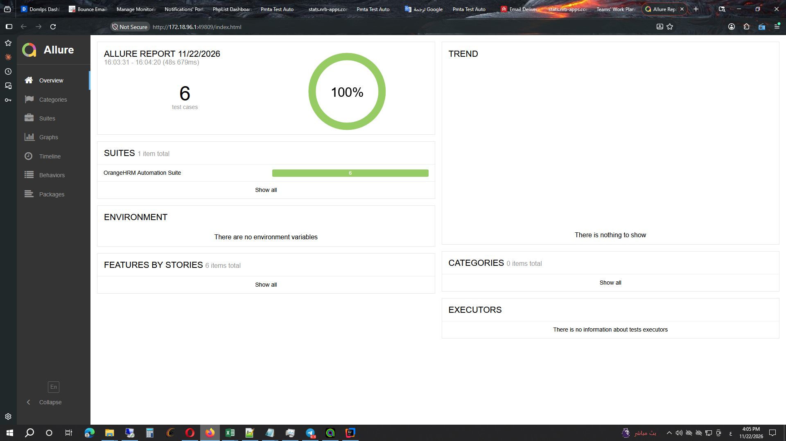

# OrangeHRM Automation Framework

A UI Test Automation Framework built using **Java, Selenium WebDriver, TestNG, and Maven** to automate and validate key functionalities of the OrangeHRM web application.

## Project Overview

This project focuses on automating important OrangeHRM functionalities using the Page Object Model (POM) design pattern to improve code reusability, maintainability, and test organization.

The framework includes automated login and Admin module test scenarios, data-driven testing, explicit waits, and automated screenshot capture on test failures.

## Technologies & Tools

- Java
- Selenium WebDriver
- TestNG
- Maven
- Page Object Model (POM)
- PageFactory
- Allure Reports
- Git & GitHub
- IntelliJ IDEA

## Automated Test Scenarios

### Login Module
- Verify login with valid credentials.
- Verify login with an invalid password.

### Admin Module
- Verify navigation to the Admin page.
- Verify user search using valid usernames.
- Verify search functionality with different username letter cases.
- Verify search behavior with an invalid username.
- Verify the Admin page title.

## Framework Features

- Page Object Model (POM) for maintainable test architecture.
- PageFactory for element initialization.
- DataProvider for data-driven testing.
- Explicit Waits for reliable element synchronization.
- TestNG Listeners for test execution monitoring.
- Automatic screenshot capture on test failures.
- Regression test suite configuration.
- Allure TestNG integration for test reporting.

## Project Structure

```text
OrangeHRM-Automation
│
├── src
│   ├── main
│   │   └── java
│   │       └── com/amr
│   │           ├── config
│   │           ├── factory
│   │           └── pages
│   │
│   └── test
│       ├── java
│       │   └── com/amr
│       │       ├── listeners
│       │       ├── tests
│       │       └── utils
│       │
│       └── resources
│           └── config.properties
│
├── docs
│   └── images
│       └── allure-report.png
│
├── testing.xml
├── pom.xml
├── README.md
└── .gitignore
```

## Test Execution

The regression suite is configured in `testing.xml`.

To execute the tests:

1. Open the project in IntelliJ IDEA.
2. Make sure the required dependencies are installed.
3. Open `testing.xml`.
4. Right-click and select **Run**.

## Latest Test Execution

| Metric | Result |
|---|---:|
| Total Tests | 6 |
| Passed | 6 |
| Failed | 0 |
| Skipped | 0 |

## Allure Test Report

The project uses Allure Reports to provide detailed test execution results.



## Author

**Amr Ahmed**

GitHub: [amr20012020](https://github.com/amr20012020)